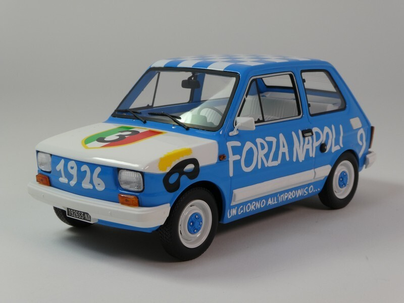

# Gran Premio di Napoli · WebGPU

**Simulatore di guida 3D WebGPU single-file a zero dipendenze: pilota la Fiat 127 SSC Napoli 1926 sul Lungomare Caracciolo e affronta le 3 epoche storiche del leggendario Circuito di Posillipo (1937 · 1955 · 2026) direttamente nel browser.**

Questo progetto nasce come fork ed evoluzione architettonica del motore WebGPU puro *Uno com escada* (ispirato a sua volta da *Abyssal Garden*), completamente riprogettato ed esteso per ambientare gare motoristiche storiche e moderne nel cuore e nella topografia reale di **Napoli**.



---

## 🎮 Come Giocare

### 1. Online (GitHub Pages)
Apri la pagina web del progetto senza scaricare o installare nulla:
👉 **[GitHub Pages Gran Premio di Napoli](https://marcorzzn.github.io/gp-napoli/)**

### 2. In Locale sul tuo Computer
1. Clona il repository o scarica i file.
2. Avvia un server locale con Node.js:
   ```bash
   npm install
   npm start
   ```
   e naviga su `http://localhost:3000`.
3. In alternativa, puoi aprire direttamente nel browser il file compilato `napoli/index.html` o `posillipo/index.html`.

> [!IMPORTANT]
> **Requisiti di Sistema:**  
> È richiesto un browser moderno con supporto nativo a **WebGPU** (Google Chrome, Microsoft Edge o Apple Safari 18+).  
> Il motore include **4 profili grafici scalabili**: dai PC portatili con grafica integrata del 2014 (*Molto Bassa - APU 2014* a 60 FPS stabili) fino a workstation moderne (*Alta - PBR Completo* con cascate d'ombra, TAA, motion blur e riflessi SSR).

---

## 🏁 I Circuiti Realizzati

### 1. Circuito del Lungomare Caracciolo (1.275 m)
* **Vettura:** **Fiat 127 Special SSC Napoli 1926** con livrea azzurra ufficiale, cofano bianco con scudetto tricolore n. 3, tetto a scacchi biancazzurri, maschera di Pulcinella, sponsor d'epoca e scritta *FORZA NAPOLI*.
* **Tracciato:** Anello cittadino da 1.275 metri in senso antiorario su Via Caracciolo con 7 chicane delimitate da rotoballe, tornante Castel dell'Ovo, tornante Mergellina e anello fronte mare della Rotonda Diaz.
* **Ambiente:** Onde animate del Golfo di Napoli nello shader, scogliere calcaree, sabbia vulcanica di Mappatella Beach, isolotto di Megaride e sagoma del Vesuvio all'orizzonte.

### 2. Circuito Storico di Posillipo (5,13 km — 3 Epoche Storiche)
Ricostruzione geometrica fedele del tracciato collinare panoramico (altimetria reale tra +108 m e +152 m s.l.m., Viale Virgilio, Parco Virgiliano, picchiata di Coroglio, Isola di Nisida, Via Boccaccio, Via Manzoni e Via Petrarca):

| Epoca | Vettura | Livrea e Specifiche | Atmosfera & Dettagli Scena |
|:---|:---|:---|:---|
| **1937** | **Alfa Romeo 12C-36** (#32) | V12 4.1L sovralimentato, 370 CV, 820 kg, ruote a raggi Borrani | Stile *Cinegiornale Luce* in bianco e nero (CSS zero-cost GPU), balle di paglia, torretta razionalista bianca |
| **1955** | **Lancia D50 Ascari** (#6) | V8 90° 2.5L di Vittorio Jano, 260 CV, 620 kg, serbatoi a siluro | VII GP di Napoli, luce calda Kodachrome, casco azzurro di Alberto Ascari, box in legno con fusti d'epoca Shell/Agip |
| **2026** | **Ferrari SF-26** (#16) | V6 Turbo Ibrido, 1.020 CV, 798 kg, gomme slick, Halo in titanio | FIA Street Circuit moderno, barriere TecPro, yacht nella baia di Nisida, *Active Aero* DRS / X-Mode |

---

## 🕹️ Comandi di Gioco

Il gioco supporta sia la **tastiera** che il **controller Gamepad USB/Bluetooth** (Xbox, PlayStation, generico):

### Controlli di Guida
| Azione | Tastiera | Gamepad |
|:---|:---|:---|
| **Accelera** | `W` oppure `↑` | Grilletto Destro (`RT` / `R2`) |
| **Frena / Retromarcia** | `S` oppure `↓` | Grilletto Sinistro (`LT` / `L2`) |
| **Sterza** | `A` `D` oppure `←` `→` | Levetta Analogica Sinistra |
| **Freno a Mano** | `Spazio` | Tasto `A` / `Croce` |
| **Active Aero (Ferrari 2026)** | Tieni premuto `Spazio` (X-Mode DRS) | Tieni premuto `A` / `Croce` |
| **Cambia Telecamera** | `C` (Inseguimento, Cofano, Bordo Pista) | Tasto `Y` / `Triangolo` |
| **Guarda Indietro** | Tieni premuto `V` | Tieni premuto `RB` / `R1` |
| **Riposiziona Auto in Pista** | `R` | Tasto `X` / `Quadrato` |
| **Pausa / Menu Impostazioni** | `Esc` | Tasto `Start` / `Options` |

### Strumenti e Scorciatoie
| Tasto | Funzione |
|:---:|:---|
| `M` | Attiva / disattiva audio sintetizzato |
| `H` | Mostra / nasconde overlay statistiche prestazioni (FPS, draw calls, frame time) |
| `F` | Modalità Guida Autonoma (AI Demo lap) |
| `B` | Benchmark automatico di 60 secondi con calcolo min/avg/max FPS |
| `1` – `6` | Pose telecamera preimpostate per immortalare la vettura e il panorama |

---

## 🛠️ Architettura e Sviluppo

Il progetto è strutturato secondo la filosofia **Zero-Dependency Single-HTML**: il codice sorgente modulare viene unito e compilato da script Node.js privi di dipendenze pesanti in un unico file HTML autocontenuto pronto per la distribuzione.

### Comandi per lo Sviluppo
```bash
# Installa le dipendenze per il server locale
npm install

# Compila tutti i bundle HTML dei circuiti (napoli/index.html e posillipo/index.html)
npm run build

# Esegui la suite completa di test (geometria tracciati, fisica Pacejka, parser GLB, server)
npm test

# Avvia il server locale di anteprima
npm start
```

### Struttura delle Cartelle
```text
gp-napoli/
├── index.html                   # Landing page hub e player unificato per GitHub Pages
├── server.js                    # Server HTTP Node.js/Express locale
├── package.json                 # Script di build, test e avvio
│
├── napoli/                      # Circuito Lungomare Caracciolo (Fiat 127)
│   ├── index.html               # Singolo file compilato (giocabile offline)
│   └── source/                  # Sorgenti JS modulari e shader WGSL
│       ├── js/                  # Matematica, motore fisico, logica di gioco, audio
│       ├── wgsl/                # Shader WebGPU PBR, ombre, mare, cielo, post-process
│       └── build.mjs            # Compilatore single-HTML
│
├── posillipo/                   # Circuito Storico di Posillipo 5,13 km (1937 · 1955 · 2026)
│   ├── index.html               # Singolo file compilato (giocabile offline)
│   └── source/                  # Vetture storiche, altimetria, mura in tufo, shader
│       ├── js/                  # 03_glb.js (parser GLB offline), 30_car_a_posillipo.js, ecc.
│       ├── wgsl/                # Shader personalizzati (final con grading epoche, ombre)
│       └── build.mjs            # Compilatore single-HTML
│
├── assets/                      # Immagini d'archivio e riferimenti storici
└── LICENSE.md                   # Licenza PolyForm Noncommercial 1.0.0
```

---

## ⚖️ Licenza

Rilasciato sotto licenza [PolyForm Noncommercial 1.0.0](LICENSE.md): libero per lo studio, la modifica, la condivisione e l'uso personale a scopo non commerciale.
