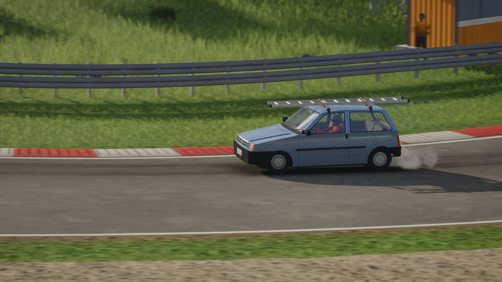
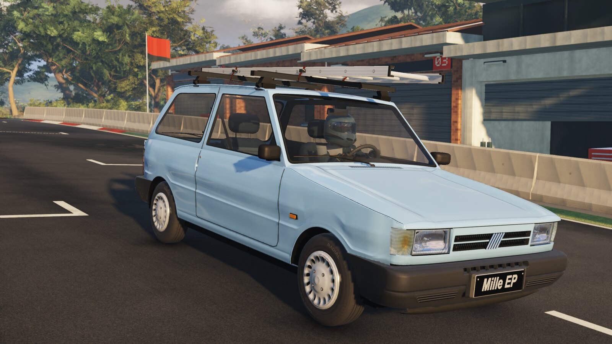
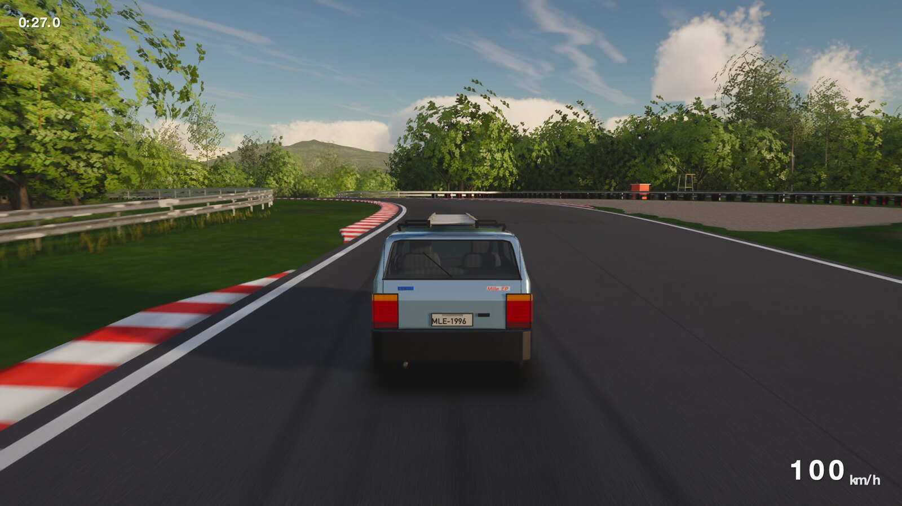
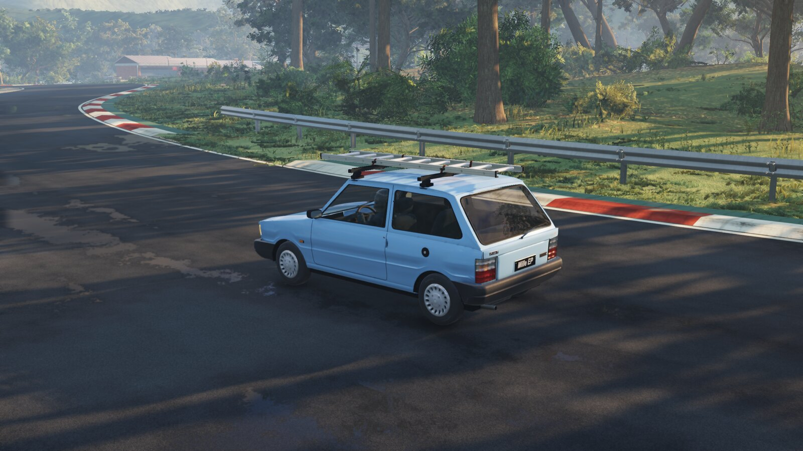

# Uno com escada

**Um Fiat Uno Mille EP 1996, com uma escada de alumínio no teto, para pilotar num circuito de corrida, direto no navegador.**

São três versões feitas a partir do mesmo pedido pelo Claude Fable 5.2, pelo Claude Opus 5.5 e pelo GPT-6.2 Astra. Cada versão é um único `index.html`. O código gera o carro, a pista, a mata e o céu, sem depender de assets externos, engine ou biblioteca 3D.



O projeto nasceu num vídeo do canal [ViktorKav](https://www.youtube.com/@vkav) sobre como escrever um pedido para a IA. O material de apoio do vídeo está em [viktorkav.com.br/apoio/uno-com-escada](https://viktorkav.com.br/apoio/uno-com-escada/).

## Jogar

Pelo navegador, sem baixar nada:

- [Versão do Fable 5.2](https://viktorkav.com.br/apoio/uno-com-escada/fable/)
- [Versão do Opus 5.5](https://viktorkav.com.br/apoio/uno-com-escada/opus/)
- [Versão do GPT-6.2 Astra](https://viktorkav.com.br/apoio/uno-com-escada/astra/)

Ou no seu computador:

1. Baixe [`fable/index.html`](fable/index.html), [`opus/index.html`](opus/index.html) ou [`astra/index.html`](astra/index.html).
2. Abra o arquivo no **Chrome** ou no **Edge**, num computador.
3. Espere o circuito carregar. No Fable e no Opus, aperte **Começar**. No Astra, acelere com `W`.

Não há nada para instalar, e a página funciona sem rede. Ela precisa de um navegador com **WebGPU**. O alvo do pedido foi um MacBook Pro M4 Max em 2560×1440; em máquina mais modesta, a taxa de quadros cai.

## As três versões

| | Fable 5.2 | Opus 5.5 | GPT-6.2 Astra |
|---|---|---|---|
| Circuito | Serra da Mata | Circuito da Serra | Serra do Lume |
| Esforço | Alto | Alto | Ultra |
| Tempo de trabalho | 7 h 12 min | 5 h | 6 h 49 min |
| Rodadas do crítico visual | 8 | 11 | 19 |
| Defeitos graves na última rodada | 4 | 5 | 0 |
| Preço de API | US$ 347,64 | US$ 87,81 | US$ 371,02 |
| Tamanho no fim do teste | 546 KB | 338 KB | 467 KB |
| Tamanho da versão jogável | 603 KB | 341 KB | 467 KB |

| Fable 5.2 | Opus 5.5 | GPT-6.2 Astra |
|---|---|---|
|  |  |  |
|  |  |  |

Cada modelo teve seu próprio crítico visual. O pedido original dava a tarefa por pronta quando restassem, no máximo, defeitos menores. O Opus encerrou por conta própria na rodada 11, avisando que a tarefa ainda não estava pronta. O Fable foi interrompido na rodada 8. O Astra foi encerrado por decisão do Victor após a rodada 19, com zero defeitos graves e três médios. [Veja o processo do Astra e as medições.](astra/PROCESSO.md)

## Controles

### Fable e Opus

A lista também aparece na tela de início dos dois jogos.

| | Teclado | Controle |
|---|---|---|
| Acelerar | `W` ou `↑` | Gatilho direito |
| Frear e dar ré | `S` ou `↓` | Gatilho esquerdo |
| Fazer curvas | `A` `D` ou `←` `→` | Analógico esquerdo |
| Freio de mão | `Espaço` | `A` |
| Trocar a câmera | `C` | `Y` |
| Olhar para trás | Segurar `V` | Segurar `RB` |
| Devolver o carro à pista | `R` | `X` |
| Pausar e abrir o menu | `Esc` | `Start` |

| Ferramenta | Tecla |
|---|---|
| Ligar e desligar o som | `M` |
| Estatísticas de desempenho | `H` |
| Benchmark: a volta roteirizada de 60 s, com média e máximo no fim | `B` |
| Assistir à volta roteirizada | `F` |
| Poses fixas de câmera | `1` a `6` |

O câmbio é automático, e a volta conta quando o carro cruza a linha de largada. O som começa depois do primeiro clique.

### GPT-6.2 Astra

O jogo abre direto na pista. Use `W` para acelerar, `S` para frear e dar ré, `A` e `D` para fazer curvas e `Espaço` para o freio de mão. `C` alterna entre três câmeras, `R` reposiciona o carro e `H` abre os controles.

## Como foi feito

A pasta [`pedidos`](pedidos) tem o texto que a IA recebeu, sem cortes:

| Arquivo | O que é |
|---|---|
| [`01-circuito.txt`](pedidos/01-circuito.txt) | O pedido do jogo. Prioridades em ordem, restrições, máquina-alvo, cena, três verificações (crítico visual, desempenho e controles) e o critério de pronto. Os três modelos receberam o mesmo texto. |
| [`02-som-e-menu.txt`](pedidos/02-som-e-menu.txt) | O pedido seguinte: controle, painel, tela de início, menu, benchmark e som sintetizado. Foi passado ao Fable 5.2 nos dois jogos, depois do teste. |
| [`03-ajustes.txt`](pedidos/03-ajustes.txt) | Três ajustes finais de texto e de volume. |

O crítico visual do primeiro pedido é um subagente novo a cada rodada, que vê só as imagens do jogo e as referências, nunca o código. As fotos do carro e as capturas usadas como referência de imagem não fazem parte deste repositório.

O molde do pedido vem do [Abyssal Garden](https://github.com/Noniv/abyssal-garden), do Noniv: um oceano 3D de 97 KB, feito do mesmo jeito.

## Mexer no código

O código legível de cada versão está na pasta `source` dela. Para montar o `index.html` de novo, use Node.js 18 ou mais novo para o Fable e o Opus, ou Python 3 para o Astra. Os scripts dispensam pacotes adicionais.

```bash
node fable/source/build.mjs
node opus/source/build.mjs
python3 astra/source/build.py
```

Cada comando reescreve o `index.html` da versão.

**Versão do Fable** ([`fable/source`](fable/source)): os arquivos de `js/` entram na página na ordem do nome.

| Arquivo | O que tem dentro |
|---|---|
| `js/10_track.js` | O circuito: traçado, elevação e zonas. **Um bom lugar para começar.** |
| `js/30_car_*.js` | O Uno: a forma da carroceria, a pintura, as peças, o rack e a escada |
| `js/31_world.js`, `js/32_props.js` | Terreno, pista, guard-rails, arquibancada, boxes e pórtico |
| `js/33_veg_*.js` | A mata: árvores, grama e os impostores de longe |
| `js/40_vehicle.js` | A física do carro |
| `js/45_game.js` | Entrada, câmeras e a volta roteirizada |
| `js/50_som.js` | O som, sintetizado na hora |
| `js/51_painel.js`, `js/52_ui.js` | Painel, tela de início, menu e benchmark |
| `wgsl/` | Os shaders: materiais, céu, sombras, pós-processamento |

**Versão do Opus** ([`opus/source`](opus/source)):

| Arquivo | O que tem dentro |
|---|---|
| `js/track.js` | O circuito. **Um bom lugar para começar.** |
| `js/car_model.js`, `js/cargfx.js` | O Uno e as malhas dele na GPU |
| `js/world.js`, `js/terrain.js`, `js/vegetation.js` | Pista, terreno e mata |
| `js/physics.js` | A física do carro |
| `js/game.js` | Carga, laço principal, entrada e câmeras |
| `js/som.js` | O som, sintetizado na hora |
| `js/painel.js` | O painel do jogo |
| `js/renderer.js`, `shaders/` | O renderizador e os shaders |

**Versão do Astra** ([`astra/source`](astra/source))

| Arquivo | O que tem dentro |
|---|---|
| `world.js`, `pavement.js` | Traçado, cenário e superfície da pista |
| `car.js`, `drive.js` | Geometria do Uno e física da pilotagem |
| `render.js`, `ambient.js` | Renderização WebGPU e iluminação |
| `main.js`, `hud.js` | Controles, câmeras, volta de teste e painel |

## Licença

[PolyForm Noncommercial 1.0.0](LICENSE.md): livre para usar, estudar, mudar e compartilhar sem fim comercial.
